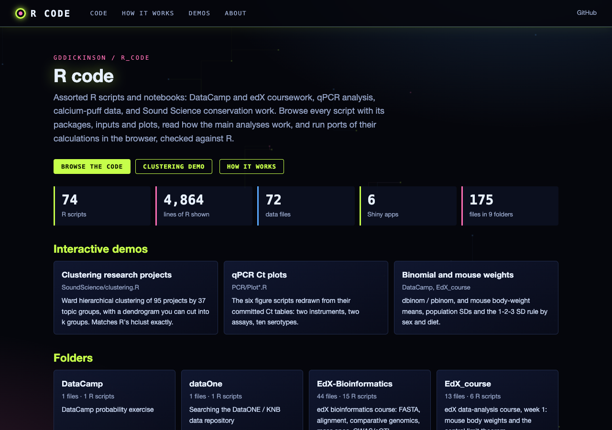
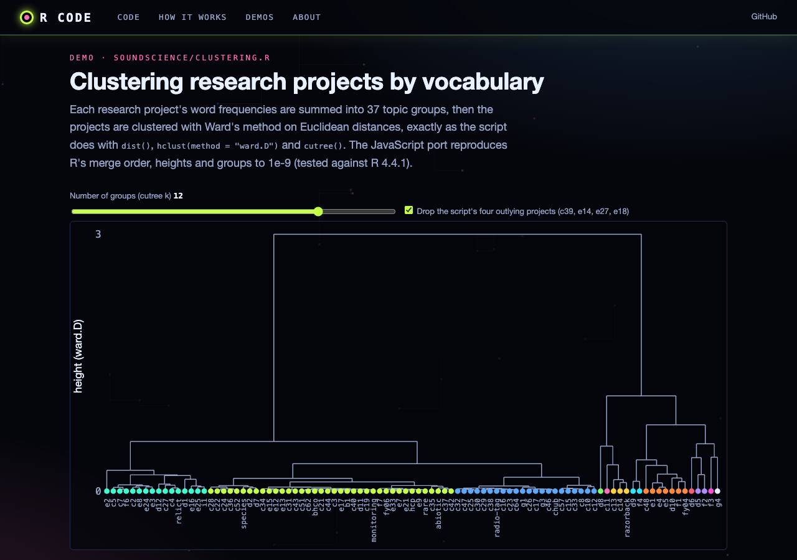
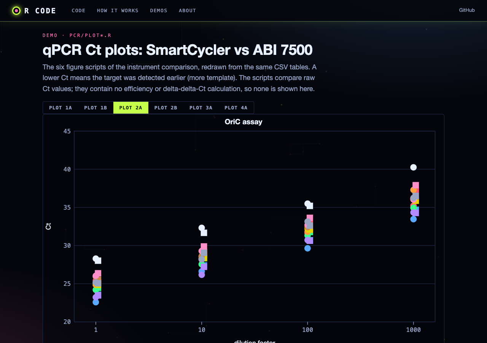
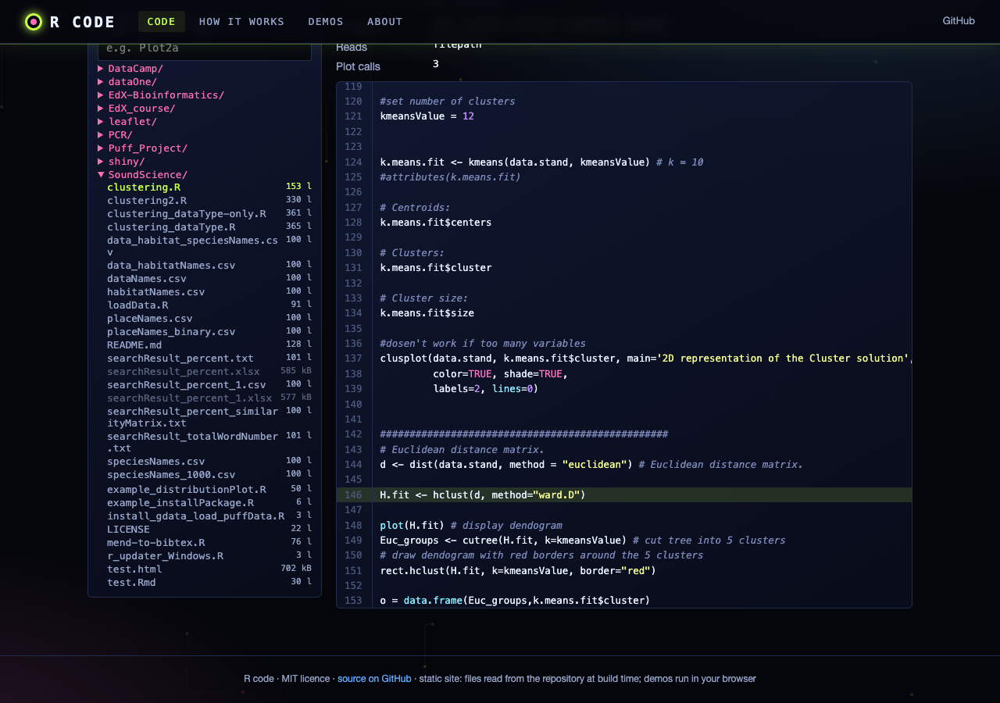

# R_code

Assorted R scripts and notebooks: DataCamp and edX coursework, qPCR analysis, calcium-puff data, and Sound Science
conservation work. MIT licence.

| Folder | Contents |
|---|---|
| `PCR/` | qPCR comparison of ABI 7500 FAST and Cepheid SmartCycler for *Salmonella* (Ct tables, plot scripts; see `PCR/README.md`) |
| `SoundScience/` | Word-frequency clustering of Lower Colorado River research reports (see `SoundScience/README.md`) |
| `EdX-Bioinformatics/`, `EdX_course/`, `DataCamp/` | Course exercises |
| `shiny/`, `leaflet/` | Shiny apps and leaflet map demos (plus the RStudio Shiny tutorial files) |
| `dataOne/`, `Puff_Project/` | DataONE / KNB search; calcium-puff data project |

## Web interface

A showcase and code explorer of this repository, with in-browser ports of some of its calculations (Ward clustering
from `SoundScience/clustering.R`, the PCR figures, `dbinom`/`pbinom`, mouse body-weight statistics), each checked
against R: **https://gddickinson.github.io/R_code/**

| Home | Clustering demo | PCR plots | Code explorer |
|---|---|---|---|
|  |  |  |  |

```bash
pip install -r requirements-web.txt
python run_web.py            # http://127.0.0.1:8254
```

Tests: `python -m pytest tests` (R-based tests run when `Rscript` is installed) and the Node tests in
`web/static/*.test.mjs`. Reference values: `Rscript scripts/make_r_fixtures.R`. File map: `INTERFACE.md`.
